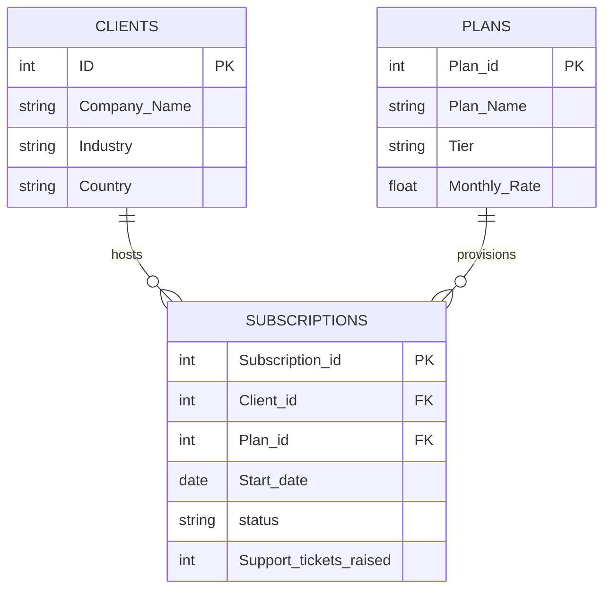

# SaaS Metrics & Subscription Analytics Platform

A relational database project designed to model, track, and analyze B2B SaaS subscription lifecycles. 
This repository provides the structural schema (DDL), sample seed data (DML), and advanced analytical SQL queries to extract critical business 
intelligence metrics like Monthly Recurring Revenue (MRR), client churn friction points, and product tier health profiles.  

##  Business Logic & Use Cases
This database architecture enables engineering and business analytics teams to:
* **Track Customer Lifecycles:** Monitor subscription transitions (`Active`, `Upgraded`, `Cancelled`).
* **Identify Product Friction:** Cross-reference operational support ticket volumes against account churn statuses to isolate software performance
    bugs or customer service bottlenecks.
* **Assess Revenue Generation:** Quantify potential vs. realized Monthly Recurring Revenue (MRR) dynamically across basic, professional, and enterprise tiers.

## Relational Schema Design

### Key Data Integrity Constraints
* **Industry Guardrails:** The `Clients` table enforces a check constraint allowing only verified operational verticals
    (`Finance`, `Healthcare`, `E-Commerce`, `Logistics`, `EdTech`).
* **Product Tiers:** The `Plans` table restricts service tiers strictly to `Basic`, `Professional`, or `Enterprise`.
* **Subscription States:** System logs are tightly bound to user paths, validating against `Active`, `Upgraded`, or `Cancelled` categories.
* **Cascading Operations:** Foreign keys are explicitly structured with `ON DELETE CASCADE` to prevent orphan log generation and preserve
    structural data integrity during cleanup scripts.

##  Getting Started

### Prerequisites
* Any standard relational database management system supporting SQL (MySQL, PostgreSQL, Microsoft SQL Server).

### Execution Sequence
1. **Schema Initialization:** Execute the DDL statements in the core script to create the schema (`Saas_Metrics_DB`).
2. **Data Seeding:** Run the `INSERT INTO` payloads to generate the foundational client base and temporal logs.
3. **Analytics Delivery:** Execute the metrics queries to extract product performance matrices.